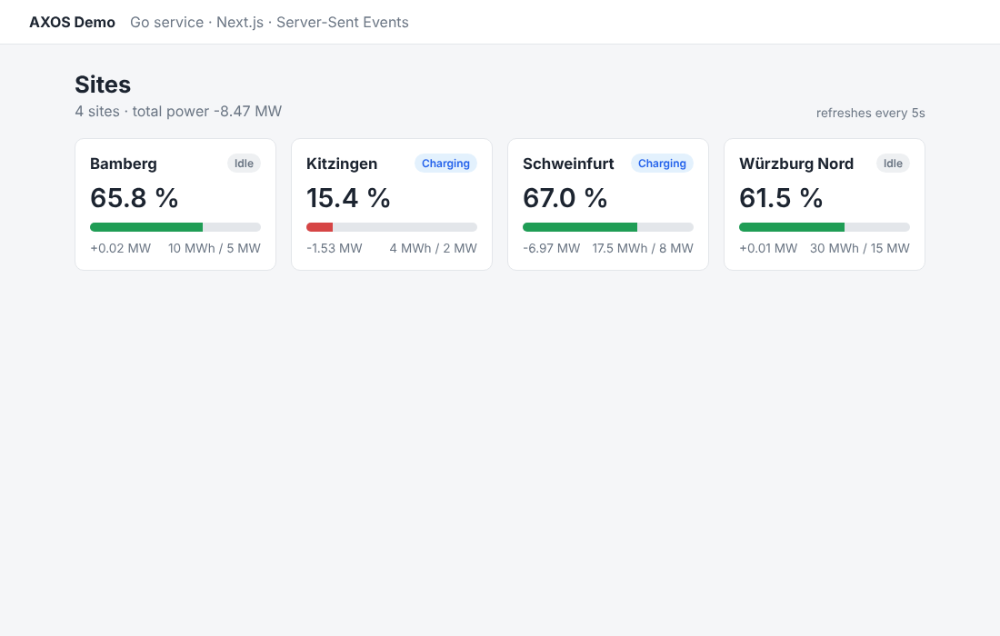
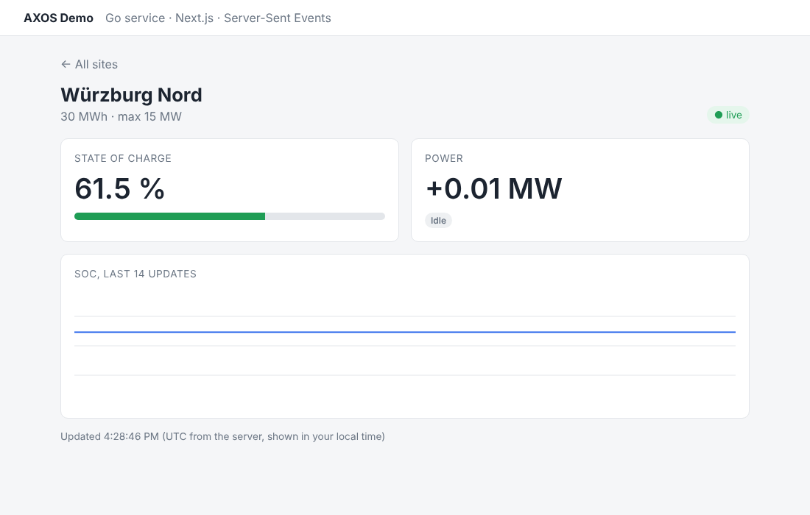

# AXOS Demo – live state of charge with Go + Next.js

A small prototype I built to get hands-on with a Go backend and a Next.js / TypeScript frontend:
a Go service simulates battery storage sites, and a Next.js app shows their state of charge (SoC) live.

| Overview (Server Component, refreshes every 5 s) | Site detail (live via Server-Sent Events) |
|---|---|
|  |  |

## Architecture

```
┌────────────────────────── Go backend (:8080) ──────────────────────────┐
│  simulation goroutine ──(every 1 s)──▶ Store (map + RWMutex)           │
│                                          │  fan-out via channels       │
│  GET /api/v1/sites            ◀──────────┤                             │
│  GET /api/v1/sites/{id}       ◀──────────┤                             │
│  GET /api/v1/sites/{id}/stream (SSE) ◀───┘  one channel per client     │
└───────────────▲───────────────────────────────────────▲────────────────┘
                │ server-side fetch (API_URL)            │ EventSource (NEXT_PUBLIC_API_URL)
┌───────────────┴──────── Next.js (:3000) ──────┐        │
│  /            Server Component: all sites     │        │
│  /sites/[id]  Server Component: initial state │        │
│               └─ LiveSite (Client Component) ─┼────────┘
└───────────────────────────────────────────────┘
```

- **Backend:** Go standard library only (Go 1.22+ routing patterns, no framework).
- **Frontend:** Next.js App Router, React, TypeScript (strict), no UI or chart library.
- 1 real second = 1 minute of site time, so the SoC visibly changes.

## Run

With Docker:

```bash
docker compose up --build
# open http://localhost:3000
```

Without Docker (Go 1.22+ and Node 20+):

```bash
cd backend && go run .            # http://localhost:8080
cd frontend && npm install && npm run dev   # http://localhost:3000
```

Tests (with the race detector):

```bash
cd backend && go test -race ./...
```

## Design decisions

- **SSE instead of WebSockets or polling.** The data only flows server → browser, SSE is plain HTTP,
  works through proxies, and the browser reconnects automatically. The page shows `● live`,
  `reconnecting`, or `stale` when no update arrived for 5 seconds – an old value that looks current
  is dangerous for an operator.
- **Server Components for the first load, a Client Component for live data.** The initial state is
  rendered on the server (fast first paint, no loading spinner); only the live part runs in the browser.
- **Slow clients can't block the system.** Each SSE client gets its own buffered channel and updates
  are sent non-blocking; a client that can't keep up misses an update instead of blocking the simulation.
- **No leaks on disconnect.** When the browser closes the connection, the request context is cancelled,
  the handler returns and the subscription is removed (`defer unsubscribe()`); covered by a test.
- **Graceful shutdown** on SIGTERM (Docker/Kubernetes) via `signal.NotifyContext` and `server.Shutdown`.
- **Small, non-root images:** distroless static image for Go (a few MB), Next.js `standalone` output.

## What I would add for production

- Real data source: MQTT ingestion from the sites instead of the simulator, idempotent writes.
- Persistence: time-series storage (e.g. TimescaleDB) with downsampling for longer time ranges.
- Authentication (OIDC) and per-customer access control on every endpoint, including the stream.
- Metrics (Prometheus), structured logging, health/readiness probes for Kubernetes.
- Fan-out across multiple backend instances (e.g. via the broker), since the in-memory store is per instance.

## Project structure

```
backend/
  main.go           server setup, simulation loop, graceful shutdown
  store.go          Site model, in-memory store, pub/sub, simulation model
  handlers.go       REST + SSE handlers, CORS, request logging
  handlers_test.go  API, SSE, simulation limits, unsubscribe
frontend/
  app/page.tsx                  overview (Server Component)
  app/sites/[id]/page.tsx       site detail, initial data (Server Component)
  app/sites/[id]/LiveSite.tsx   live updates via EventSource (Client Component)
  components/                   SocBar, Sparkline (SVG), AutoRefresh
  lib/api.ts                    types shared with the Go API + fetch helpers
docker-compose.yml
```
